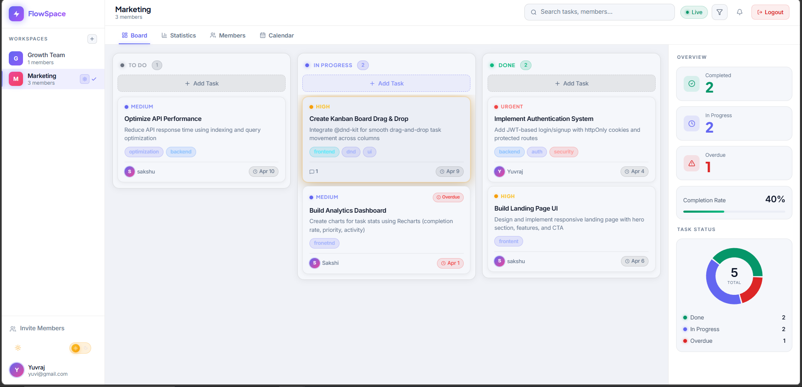
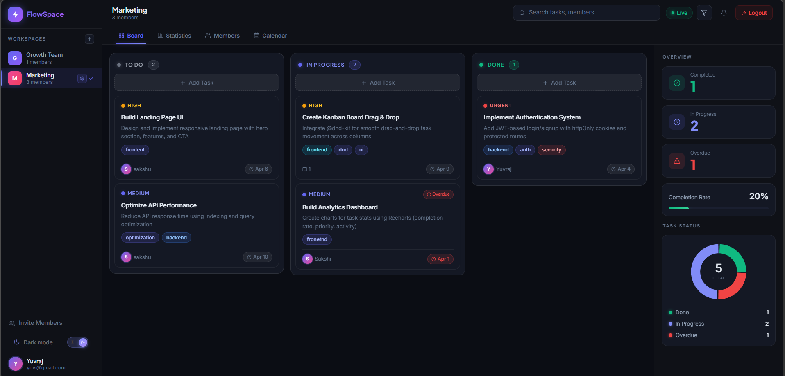
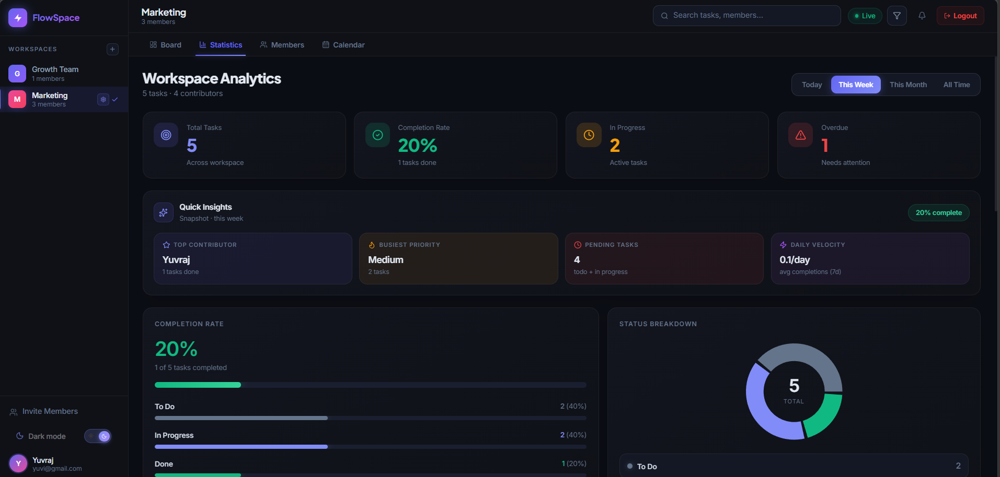
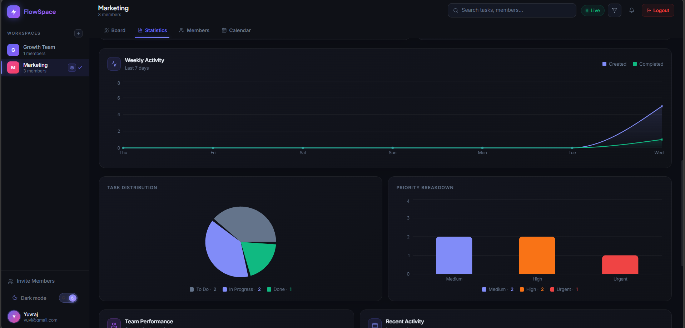
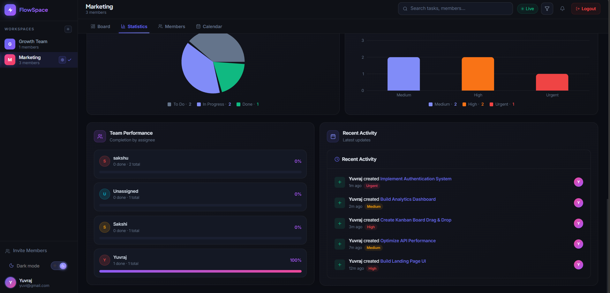
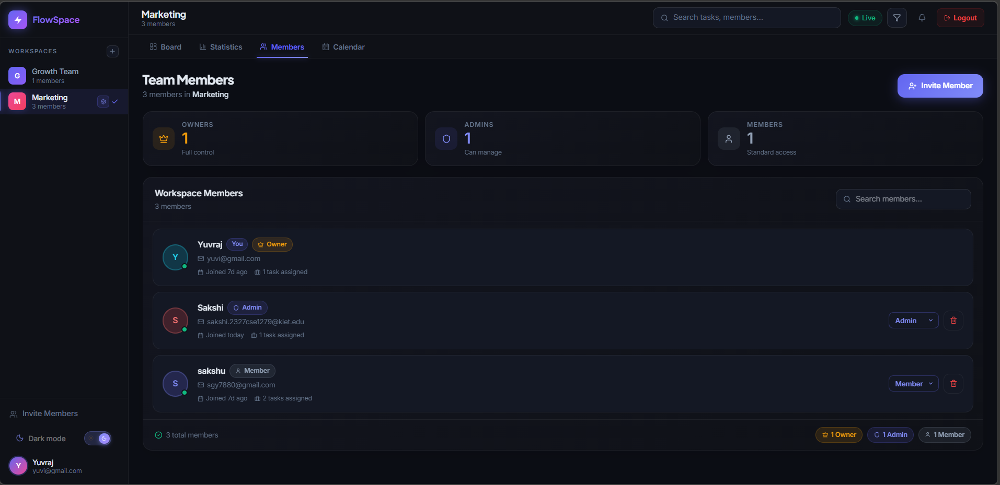
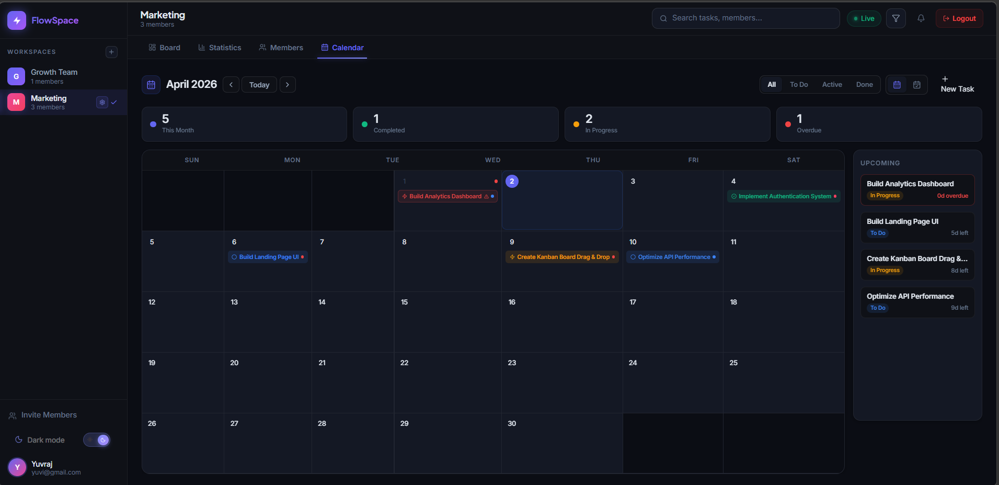
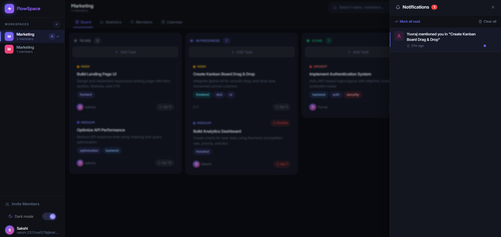

<div align="center">


# ⚡ FlowSpace

### Real-time Collaborative Task Management — Built for Modern Teams



[](https://flow-space-black.vercel.app)
[](https://reactjs.org)
[](https://nodejs.org)
[](https://mongodb.com)
[](https://socket.io)
[](https://redux-toolkit.js.org)

</div>

---

## 📌 Overview

**FlowSpace** is a full-stack, real-time collaborative task management application. Teams create shared workspaces, manage tasks on a drag-and-drop Kanban board, collaborate live with Socket.IO, and track progress through analytics, in an interface with full dark/light mode support.

> A MERN stack project with httpOnly cookie auth, role-based access control, server-driven real-time sync across all connected clients, and a responsive UI from mobile to desktop.

## 💡 Problem & Solution

Traditional task tools lack real-time collaboration, which leads to delays and inconsistent task states.

FlowSpace uses WebSockets (Socket.IO) so every teammate sees changes instantly, with optimistic UI updates so the board still feels instant for the person acting.

---

## 🌐 Live Demo

**[https://flow-space-black.vercel.app](https://flow-space-black.vercel.app)**

Sign up with any email to try it, or open it in two browser tabs with two accounts to see real-time sync.

---

## ✨ Features

### 🗂️ Workspace Management
- Multiple workspaces with custom names, descriptions and color themes
- Invite members by email with a role (Owner / Admin / Member)
- Role-based access control:
  - **Owner:** everything, including changing roles, inviting admins and removing admins
  - **Admin:** edit workspace, invite and remove regular members
  - **Member:** create and work on tasks
- Export workspace data as **JSON** or **CSV** (CSV cells are escaped against spreadsheet formula injection)
- 3-step confirmation for irreversible workspace deletion

### 📋 Kanban Board
- Drag-and-drop across **To Do**, **In Progress** and **Done** using `@dnd-kit`
- Optimistic updates, rolled back cleanly if the API call fails
- Real-time sync: a teammate's create / move / edit / delete appears on your board within milliseconds
- Search by title, description or tags; filter by priority, status and assignee

### ✅ Task Management
- Title, description, priority (Low / Medium / High / Urgent), status, assignee, due date, tags
- Overdue detection with visual indicators
- Comments with **@mention** autocomplete (only workspace members can be mentioned)
- Real-time comment add and delete

### 📊 Analytics Dashboard
- Completion rate, status breakdown (donut), priority breakdown (bar)
- 7-day activity chart (created vs completed)
- Team leaderboard with per-member completion rates
- Quick insights: top contributor, busiest priority, daily velocity, pending count

### 📅 Calendar View
- Month and week views with tasks plotted by due date
- Overdue indicators and an upcoming-tasks panel
- Click a date to create a task with that due date pre-filled

### 🔔 Notifications
- Real-time delivery via Socket.IO
- Types: task assigned / unassigned, commented, mentioned, status changed, member joined / left, role changed
- Mark one or all as read, delete one or clear all, live unread badge

### 🌗 Theme System & 📱 Responsive Design
- Dark and light mode, persisted in localStorage, driven by CSS variables
- Mobile-first layouts, collapsible sidebar, scrollable Kanban on small screens

---

## ⚡ Key Technical Highlights

- **Server-driven real-time:** writes go through REST (with auth and permission checks), and the server broadcasts the result to the workspace room
- Workspace-based Socket.IO rooms; automatic room re-join and data refetch after a reconnect
- Optimistic UI with rollback
- JWT in httpOnly cookies, role-based access control
- Server-side validation and a 58-test Jest suite
- Modular backend (controllers, middleware, models, utils)

## 📸 Screenshots

### 📋 Kanban Board


### 📊 Analytics Dashboard


### 📈 Insights & Performance
| Weekly Activity | Task Distribution |
|----------------|------------------|
|  |  |

### 👥 Team Members


### 📅 Calendar View


### 🔔 Notifications Panel


---

## ⚡ Challenges & Solutions

- **Real-time consistency**
  - Remote moves patch only the changed fields and insert the card at the right index instead of replacing the whole task.
- **Trusting the client over a socket**
  - Early versions let clients emit `task:create` / `task:move` / `task:delete` over the socket. Any user could broadcast fake events, or touch tasks in other workspaces. Now all writes go through REST and only the server broadcasts.
- **Silent loss of live updates after reconnect**
  - A reconnect creates a new socket that is in no rooms. The client now re-joins its workspace room on every `connect` and refetches to catch missed events.
- **Duplicate notifications and double events**
  - The workspace socket hook runs once (in the dashboard), and the global notification listener only refreshes the unread count.
- **Drag-and-drop ordering**
  - Moves run in a MongoDB transaction (with a fallback for standalone `mongod`), positions are clamped, and gaps are closed on delete.
- **Secure authentication**
  - httpOnly cookie JWT against XSS, type-checked login inputs against NoSQL injection, and a DB check so a deleted user's token stops working.

---

## 🛠️ Tech Stack

### Frontend
| Technology | Purpose |
|---|---|
| **React 19** | UI library with hooks |
| **Redux Toolkit** | Global state management |
| **Socket.IO Client** | Real-time events |
| **@dnd-kit** | Drag-and-drop |
| **Recharts** | Analytics charts |
| **React Router v7** | Client-side routing |
| **React Hot Toast** | Toast notifications |
| **Lucide React** | Icons |

### Backend
| Technology | Purpose |
|---|---|
| **Node.js + Express** | REST API |
| **MongoDB + Mongoose** | Database + ODM |
| **Socket.IO** | WebSocket server |
| **bcryptjs** | Password hashing |
| **jsonwebtoken** | JWT |
| **cookie-parser** | httpOnly cookie handling |
| **express-rate-limit** | Rate limiting on auth routes |
| **Jest** | Tests |

### Infrastructure
| Service | Usage |
|---|---|
| **Vercel** | Frontend |
| **Render / Railway** | Backend |
| **MongoDB Atlas** | Database |

---

## 🏗️ Architecture

```
flowspace/
├── client/                          # React frontend (Vite)
│   └── src/
│       ├── components/              # KanbanBoard, TaskCard, StatisticsPanel, CalendarView, MembersPanel, ...
│       ├── context/                 # SocketContext (socket + online users), ThemeContext
│       ├── hooks/                   # useWorkspaceSocket, useNotificationSocket, ...
│       ├── pages/                   # Dashboard, Login, Signup
│       ├── redux/slices/            # auth, task, workspace, notification, statistics
│       ├── services/api.js          # Axios instance + interceptors
│       └── utils/                   # socketId, toast, ...
│
└── server/
    ├── src/
    │   ├── config/                  # socket.js, origins.js (CORS allow-list)
    │   ├── controllers/             # auth, task, workspace, notification
    │   ├── middelware/              # auth, workspace (roles), task, socketAuth, rateLimiter
    │   ├── models/                  # User, Workspace, Task, Notification
    │   ├── routes/
    │   ├── sockets/workspaceSocket.js  # rooms, presence, typing / editing indicators
    │   ├── utils/                   # realtime, validators, httpErrors, withTransaction
    │   └── server.js
    └── tests/                       # Jest tests (58)
```

---

## 🔐 Authentication & Security

- **httpOnly cookie JWT**, never stored in localStorage
- **Auth on every request:** middleware verifies the cookie and checks the user still exists
- **Role-based access control:** Owner > Admin > Member, enforced on the server
- **Socket auth:** the handshake verifies the same JWT; connections are dropped when the token expires, and removed members are evicted from the workspace room
- **Strict CORS allow-list** (no wildcards), shared by Express and Socket.IO
- **Input validation:** type checks on login (NoSQL-injection safe), ID validation, field whitelists on task updates, mentions and assignees restricted to workspace members
- **Rate limiting** on login / signup (only failed attempts count; `trust proxy` set in production)
- **No internal error details** are returned to clients in production
- **Full Redux reset on logout** so no data leaks between sessions

---

## ⚡ Real-time Architecture

```
Client A                      Server                        Client B
   │                             │                             │
   │── REST: move task ────────► │  auth + role + validation   │
   │   (optimistic UI)           │  save to MongoDB            │
   │                             │── task:moved ─────────────► │
   │                             │   (to the workspace room)   │
   │                             │                             │
   │── REST: add comment ──────► │── comment:added ──────────► │
   │                             │── notification:new ───────► │ (mentioned / assigned user)
```

Key design decisions:
- **Writes go through REST, the server broadcasts.** Permission checks live in one place, and a client cannot send fake events to other users.
- **Sender is excluded** from the broadcast (via the client's socket id), so the person who acted doesn't get a duplicate.
- **Per-user rooms** (`user:<id>`) carry notifications, so every open tab of a user receives them.
- **Reconnect-safe:** the client re-joins its room and refetches tasks after every reconnect.
- **Presence:** the server tracks who is online per workspace (deduplicated across tabs).

---

## 🚀 Getting Started

### Prerequisites
- Node.js 18+
- MongoDB (Atlas, or a local replica set; a standalone `mongod` also works, task moves just run without a transaction)

### 1. Clone

```bash
git clone https://github.com/templehubsakshi/FlowSpace.git
cd FlowSpace
```

### 2. Backend

```bash
cd server
npm install
```

Create `server/.env` (see `.env.example`):
```env
PORT=5000
MONGO_URI=mongodb+srv://<user>:<password>@<cluster>.mongodb.net/flowspace
JWT_SECRET=a-long-random-string
NODE_ENV=development
CLIENT_URLS=
```

```bash
npm run dev
```

### 3. Frontend

```bash
cd client
npm install
```

Create `client/.env`:
```env
VITE_API_URL=http://localhost:5000/api
VITE_SOCKET_URL=http://localhost:5000
```

```bash
npm run dev
```

Open `http://localhost:5173`.

### 4. Run the tests

```bash
cd server
npm test
```

---

## 🔑 Environment Variables

### Server (`server/.env`)
| Variable | Description | Required |
|---|---|---|
| `PORT` | Server port (default 5000) | No |
| `MONGO_URI` | MongoDB connection string | Yes |
| `JWT_SECRET` | Secret for signing JWTs; the server refuses to start without it | Yes |
| `NODE_ENV` | `development` or `production`. Set `production` when deployed (secure cookies, `trust proxy`, generic errors) | Yes |
| `CLIENT_URLS` | Extra allowed browser origins, comma-separated, exact match (e.g. a Vercel preview URL or custom domain) | No |

`localhost` dev ports and the production Vercel URL are already in the default allow-list.

### Client (`client/.env`)
| Variable | Description | Required |
|---|---|---|
| `VITE_API_URL` | Backend API base URL | Yes (in production) |
| `VITE_SOCKET_URL` | Socket.IO server URL | Yes (in production) |

---

## 📡 API Reference

### Auth
| Method | Endpoint | Description | Auth |
|---|---|---|---|
| POST | `/api/auth/signup` | Register | No |
| POST | `/api/auth/login` | Login, sets httpOnly cookie | No |
| GET | `/api/auth/me` | Verify session | Yes |
| POST | `/api/auth/logout` | Clear cookie | No |

### Workspaces
| Method | Endpoint | Description | Auth |
|---|---|---|---|
| GET | `/api/workspaces` | My workspaces | Yes |
| POST | `/api/workspaces` | Create workspace | Yes |
| GET | `/api/workspaces/:id` | Get workspace | Member |
| PUT | `/api/workspaces/:id` | Update workspace | Admin+ |
| DELETE | `/api/workspaces/:id` | Delete workspace | Owner |
| POST | `/api/workspaces/:id/invite` | Invite member by email (inviting an admin: owner only) | Admin+ |
| DELETE | `/api/workspaces/:id/members/:memberId` | Remove member (removing an admin: owner only) | Admin+ |
| POST | `/api/workspaces/:id/leave` | Leave workspace | Member |
| PATCH | `/api/workspaces/:id/members/:memberId/role` | Change member role | Owner |

### Tasks
| Method | Endpoint | Description | Auth |
|---|---|---|---|
| GET | `/api/tasks/workspace/:workspaceId` | All tasks, grouped by status | Member |
| GET | `/api/tasks/:id` | Get one task | Member |
| POST | `/api/tasks` | Create task | Member |
| PUT | `/api/tasks/:id` | Update task | Member |
| DELETE | `/api/tasks/:id` | Delete task | Member |
| PATCH | `/api/tasks/:id/move` | Move task (status + order) | Member |
| POST | `/api/tasks/:id/comments` | Add comment with @mentions | Member |
| DELETE | `/api/tasks/:id/comments/:commentId` | Delete comment | Member |

### Notifications
| Method | Endpoint | Description | Auth |
|---|---|---|---|
| GET | `/api/notifications` | List | Yes |
| GET | `/api/notifications/unread-count` | Unread count | Yes |
| PATCH | `/api/notifications/mark-all-read` | Mark all as read | Yes |
| PATCH | `/api/notifications/:id` | Mark one as read | Yes |
| DELETE | `/api/notifications/:id` | Delete one | Yes |
| DELETE | `/api/notifications` | Clear all | Yes |

---

## 🔌 Socket Events

Writes happen over REST. Sockets are used for rooms, presence, typing indicators and for the server to push updates.

### Client → Server
| Event | Payload | Description |
|---|---|---|
| `workspace:join` | `workspaceId` | Join a workspace room (membership is verified) |
| `workspace:leave` | `workspaceId` | Leave the room |
| `comment:typing` | `{ workspaceId, taskId, ... }` | Typing indicator |
| `task:editing-start` / `task:editing-end` | `{ workspaceId, taskId }` | Editing indicator |

### Server → Client
| Event | Description |
|---|---|
| `task:created` / `task:updated` / `task:moved` / `task:deleted` | Task changes, broadcast after a successful REST call |
| `comment:added` / `comment:deleted` | Comment changes |
| `notification:new` | New notification for this user |
| `user:joined` / `user:left` / `workspace:online-users` | Presence |
| `workspace:removed` / `workspace:deleted` | You were removed, or the workspace was deleted |
| `comment:typing` / `task:locked` / `task:unlocked` | Typing and editing indicators from teammates |

---

## 🎨 Design System

A custom CSS-variable design system:
- **Two-layer theming:** variables on `:root` (light) and `.dark`
- **Tokens:** surfaces, borders, text hierarchy, brand, status colors, shadows, transitions
- **Responsive breakpoints:** 480px, 768px, 900px (sidebar collapse), 1024px, 1200px

---

## 🗺️ Roadmap

- Presence avatars in the UI (the data is already available from the server)
- JWT revocation on logout (token versioning)
- Password reset and email verification

---

## 🤝 Contributing

1. Fork the repository
2. Create your branch: `git checkout -b feature/amazing-feature`
3. Commit: `git commit -m 'Add amazing feature'`
4. Push: `git push origin feature/amazing-feature`
5. Open a Pull Request

---

## 👨‍💻 Author

Built by **Sakshi Gupta**

[](https://github.com/templehubsakshi)

---

<div align="center">

**[⬆ Back to top](#-flowspace)**

If you found this project useful, please consider giving it a ⭐

</div>
